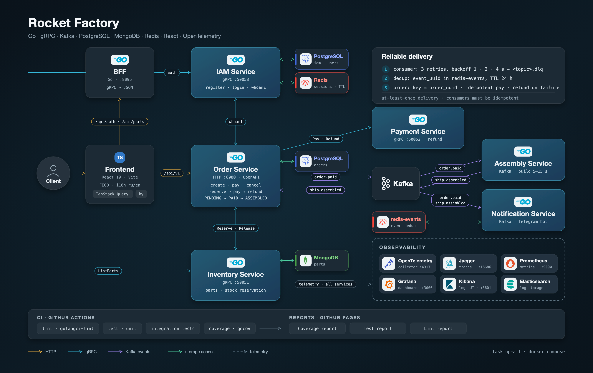

# MSA_Rocket_Factory


[](https://github.com/aidar-khabibullin/MSA_Rocket_Factory/actions/workflows/ci.yml)

📊 **Отчеты о качестве кода:** 
- 📊 [Coverage Report](https://aidar-khabibullin.github.io/MSA_Rocket_Factory/) - покрытие бизнес-логики тестами (internal пакеты)
- 🧪 [Test Report](https://aidar-khabibullin.github.io/MSA_Rocket_Factory/tests/) - результаты unit и интеграционных тестов
- 🔍 [Lint Report](https://aidar-khabibullin.github.io/MSA_Rocket_Factory/lint/) - результаты статического анализа кода

> **Примечание:** Покрытие кода рассчитывается только для бизнес-логики (пакеты `internal/`), исключая `mocks`, `test` пакеты и `main.go` файлы.

## Описание

Проект: микросервисная система «Фабрика ракет» на Go (монорепозиторий с go.work).



## Сервисы

| Сервис | Назначение | Транспорт | Хранилище |
|---|---|---|---|
| `order` | Создание и оплата заказов | HTTP (OpenAPI, `:8080`), Kafka | PostgreSQL |
| `inventory` | Каталог деталей | gRPC (`:50051`) | MongoDB |
| `payment` | Оплата заказа | gRPC (`:50052`) | - |
| `iam` | Пользователи, сессии, JWT | gRPC (`:50053`) | PostgreSQL + Redis |
| `assembly` | Сборка ракеты после оплаты | Kafka | - |
| `notification` | Уведомления пользователю (Telegram) | Kafka, gRPC-клиент к `iam` | - |

Общий код: `platform/` (логгер, Kafka, middleware, трассировка, метрики) и `shared/` (protobuf/OpenAPI-контракты).

### Поток заказа

```
Клиент ──HTTP──▶ order ──gRPC──▶ inventory   (подбор деталей)
                   │     ──gRPC──▶ payment     (оплата)
                   │     ──gRPC──▶ iam         (проверка пользователя)
                   │
                   └─ Kafka: order.paid ──▶ assembly ──▶ Kafka: ship.assembled ──┐
                                   │                                             │
                                   └──▶ notification (Telegram) ◀────────────────┤
                                                                  order ◀────────┘ (статус заказа)
```

Топики Kafka: `order.paid` (публикует `order`) и `ship.assembled` (публикует `assembly`).

## Требования

- [Go](https://go.dev/dl/) 1.24.4+
- [Docker](https://docs.docker.com/get-docker/) и Docker Compose
- [Task](https://taskfile.dev/installation/)
- Node.js (для `redocly` при сборке OpenAPI-спецификаций)

Остальные инструменты (golangci-lint, buf, ogen, mockery, envsubst и др.) устанавливаются в `./bin` командами `task`.

## Запуск приложения в Docker Compose

```bash
task up-all      # поднять core-инфраструктуру и все сервисы
task down-all    # остановить и удалить контейнеры
```

При первом запуске `.env`-файлы создаются автоматически из шаблонов (`task env:generate`):
значения по умолчанию берутся из `deploy/env/.env.template`, а `deploy/env/.env` и `deploy/compose/*/.env`
в git не хранятся. Перед использованием вне локальной машины замените пароли и JWT-секреты.

Отдельные сервисы: `task up-<service>` / `task down-<service>` (`inventory`, `payment`, `order`, `iam`, `assembly`, `notification`).

### Инфраструктура (core)

| Компонент | URL |
|---|---|
| Grafana | http://localhost:3000 |
| Prometheus | http://localhost:9090 |
| Jaeger | http://localhost:16686 |
| Kafka UI | http://localhost:8090 |

Описание метрик и дашбордов: [docs/metrics.md](docs/metrics.md).

## Разработка

Полный список команд: `task --list`.

```bash
task test            # unit-тесты всех модулей (с -race)
task test-coverage   # покрытие бизнес-логики (internal/service, internal/repository)
task lint            # golangci-lint
task format          # gofumpt + gci
task gen             # генерация кода (proto, OpenAPI)
task mockery:gen     # генерация моков
```

Интеграционные тесты помечены build-тегом `integration` и запускаются отдельно: `task test-integration`.
Часть тестов использует testcontainers, поэтому для них нужен запущенный Docker.

> **mockery и версия Go.** Mockery v2.53.x не умеет загружать пакеты под Go 1.25+ (ошибка
> `package "context" without types`). Если локально стоит более новый Go, запускайте генерацию так:
> `GOTOOLCHAIN=go1.24.4 task mockery:gen`.

## CI

GitHub Actions (`.github/workflows`): линтер, unit- и интеграционные тесты, отчёт о покрытии (публикуется на GitHub Pages)
и проверка уязвимостей `govulncheck` (`security.yml`, также раз в неделю). Версии Go и инструментов берутся из `Taskfile.yml`.
Зависимости обновляет Dependabot (`.github/dependabot.yml`).
