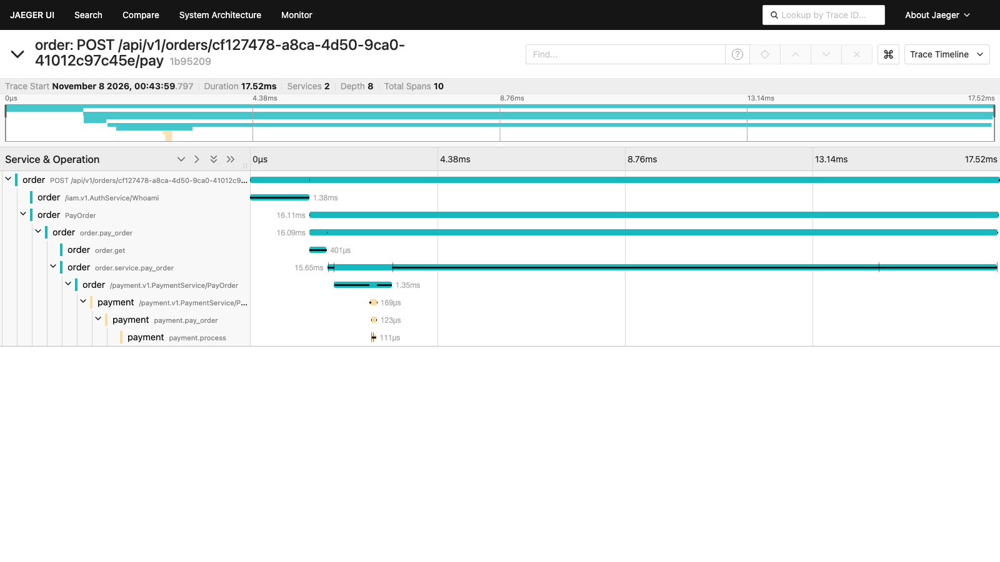

# Нагрузочное тестирование

Сценарный генератор нагрузки для HTTP API сервиса `order` лежит в `scripts/loadtest/`
(только стандартная библиотека Go, без внешних инструментов).

```bash
task up-all                                   # поднять стек
task load-test                                # параметры по умолчанию
task load-test -- -workers 50 -duration 20s -pay 20 -race 20
```

`run.sh` сам регистрирует пользователя, логинится в `iam` и берёт деталь из `inventory`,
затем запускает четыре фазы:

| Фаза | Что делает |
|---|---|
| `create` | `POST /api/v1/orders` в N воркеров в течение `-duration` |
| `get` | `GET /api/v1/orders/{uuid}` по созданным заказам |
| `pay` | оплата `-pay` заказов |
| `race` | `-race` одновременных оплат **одного** заказа; корректный результат: ровно одна успешная |

> Каждая оплата публикует `order.paid`, и `assembly` собирает заказ 5–15 секунд. Поэтому
> `-pay` по умолчанию небольшой: большое число оплат создаёт очередь в Kafka на минуты.

## Результаты

Среда: ноутбук (macOS, Apple Silicon), весь стек в Docker (в том числе Elasticsearch, Jaeger,
Grafana), 20 воркеров, фазы create/get по 10 секунд. Это **локальные цифры на одной машине**,
а не характеристика системы под реальной нагрузкой.

### Прогон 1: до исправления гонки (чистый стек)

| Фаза | Запросов | RPS | p50 | p95 | p99 | Коды ответа |
|---|---:|---:|---|---|---|---|
| create order | 18699 | 1869 | 8.6ms | 23.1ms | 43.3ms | 200×18699 |
| get order | 35120 | 3511 | 3.9ms | 14.3ms | 33.4ms | 200×35120 |
| pay order (30 шт.) | 30 | 216 | 90.3ms | 100.9ms | 101.2ms | 200×30 |
| race: 20 оплат одного заказа | 20 | 1065 | 10.5ms | 18.4ms | 18.4ms | 200×20 |

**Успешных оплат одного заказа: 20 из 20.** Это дефект: заказ оплачивается и публикует
`order.paid` столько раз, сколько параллельных запросов успело пройти проверку статуса.

### Прогон 2: после `UpdateOrderIfStatus`

| Фаза | Запросов | RPS | p50 | p95 | p99 | Коды ответа |
|---|---:|---:|---|---|---|---|
| create order | 4890 | 488 | 12.9ms | 65.5ms | 131.9ms | 200×4890 |
| get order | 28375 | 2833 | 4.7ms | 18.4ms | 47.3ms | 200×28375 |
| pay order (30 шт.) | 30 | 74 | 307.9ms | 311.2ms | 312ms | 200×30 |
| race: 20 оплат одного заказа | 20 | 216 | 67.3ms | 85.8ms | 85.8ms | 200×1 409×19 |

**Успешных оплат одного заказа: 1 из 20**, остальные 19 получили `409`. Исправление работает.

### Как читать сравнение

- **Корректность** (гонка) сравнивать можно: 20 из 20 против 1 из 20.
- **Скорость сравнивать нельзя.** Между прогонами среда деградировала: после первой нагрузки
  Elasticsearch занимал 650% CPU, а экспорт трейсов и метрик из `order` падал по таймауту.
  Об этом говорит и то, что фаза `create`, код которой исправление не затрагивало, тоже
  замедлилась с 1869 до 488 RPS. Контролируемого A/B-замера (одна и та же среда, чередование
  версий) я не делал, поэтому вклад самого исправления в задержку неизвестен. Условный
  `UPDATE` отличается от прежнего одним дополнительным условием по `WHERE`.
- Для честных цифр перед публикацией стоит перезапустить стек, дать ему успокоиться
  и повторить прогон на одной версии несколько раз.

## Трассировка

Трасса оплаты (`order` → `iam` Whoami → `payment`), 10 спанов, 17.5 мс:



Скриншоты дашбордов Grafana пока не добавлены.
